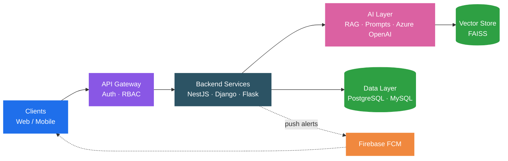

<!-- ============================== HEADER ============================== -->

  

  

  
  
  
  
  

  
  
  
  
  

---

<!-- ============================== ABOUT ============================== -->
## About Me

Final-year **B.Tech (AI & Data Science)** student with hands-on backend engineering experience across **NestJS, Django, and Flask**. I build production systems that handle **1,000+ records** with real-time notifications and role-based access control, and I design scalable REST APIs, relational schemas, and CI/CD workflows. I also build **RAG and LLM-based systems**.

> **Seeking a Software Engineer role** to apply backend architecture and full-stack development skills in a production environment.

<table align="center">
  <tr>
    <td align="center"><h3>1,000+</h3>records handled in production systems</td>
    <td align="center"><h3>5</h3>industry roles & internships</td>
    <td align="center"><h3>3</h3>backend frameworks NestJS · Django · Flask</td>
    <td align="center"><h3>1</h3>patent application (published Jan 2026)</td>
  </tr>
</table>

---

<!-- ============================== TECH STACK ============================== -->
## Tech Stack

  

  

  

  
  
  
  
  
  
  
  
  
  
  
  

---

<!-- ============================== ARCHITECTURE ============================== -->
## How I Build AI Systems

The AI is never the whole system. It is one accountable service inside one.

---

<!-- ============================== EXPERIENCE ============================== -->
## Experience

| Period | Role | Organization | Focus |
|:---|:---|:---|:---|
| **Sep 2026 – Dec 2026** | Digital Transformation Fellow | Confederation of Indian Industry (CII) | DX-EDGE program: technology adoption with Cloud, AI/ML, Data Analytics, Cybersecurity |
| **Mar 2026 – Jun 2026** | Software Development Engineer Intern | GH Induction India Pvt Ltd | NestJS · MySQL · Firebase FCM |
| **Mar 2024 – Mar 2026** | AI Product Developer | Maestrominds | Flask · Azure OpenAI · FAISS RAG |
| **Jan 2025 – Feb 2025** | Web Development Intern | Saint-Gobain India (INDEC 4.0) | Django · PostgreSQL · RBAC |
| **Jul 2024 – Jan 2025** | Data Analyst Intern | Vebbox Software Solutions | Python · UiPath · Data pipelines |

<b>View responsibilities and impact</b>

 

**Digital Transformation Fellow, CII** *(Sep 2026 – Dec 2026)*
- Through the DX-EDGE program, collaborating with industry mentors and technology solution providers to identify technology adoption challenges and support scalable solutions using Cloud, AI/ML, Data Analytics, and Cybersecurity.

**Software Development Engineer Intern, GH Induction India** *(Mar 2026 – Jun 2026)*
- Engineered core NestJS backend modules for service ticket lifecycle management.
- Designed MySQL schemas to handle 1,000+ records.
- Integrated Firebase Cloud Messaging (FCM) for real-time technician alerts on Android devices.

**AI Product Developer, Maestrominds** *(Mar 2024 – Mar 2026)*
- Built a GenAI coaching platform on Flask and Azure OpenAI.
- Implemented a RAG engine (FAISS) that adapts to coaching frameworks such as GROW and STAR and provides real-time conversational feedback.

**Web Development Intern, Saint-Gobain India** *(Jan 2025 – Feb 2025)*
- Developed a full-stack enterprise asset management system using Django and PostgreSQL.
- Implemented RBAC and complex relational schemas to secure business-critical inventory data.

**Data Analyst Intern, Vebbox Software Solutions** *(Jul 2024 – Jan 2025)*
- Automated data ingestion pipelines with Python and UiPath, converting unstructured data into JSON to speed up AI model training preparation.

---

<!-- ============================== PROJECTS ============================== -->
## Featured Projects

<table>
  <tr>
    <td width="50%" valign="top">
      <h3>Coact.ai</h3>
      <b>AI-Powered Coaching Simulator</b> · Client project, Maestrominds · Mar 2026 – Present
        
      GenAI coaching platform whose RAG engine adapts to <b>GROW</b> and <b>STAR</b> frameworks and gives coaches real-time conversational feedback.
        
      
      
      
      
    </td>
    <td width="50%" valign="top">
      <h3>ThermoRevive</h3>
      <b>Electricity from Transformer Waste Heat</b> · Patent App. No. 202541114252 A · Published Jan 2026
        
      Thermoelectric system converting transformer waste heat into usable DC electricity, with a real-time CMS dashboard for sensor streaming and predictive maintenance. ROS2 digital twin in progress.
        
      
      
      
    </td>
  </tr>
  <tr>
    <td width="50%" valign="top">
      <h3>Enterprise Asset Lifecycle Management</h3>
      <b>Intern project</b> · Saint-Gobain (INDEC 4.0) · Jan 2025 – Feb 2025
        
      Scalable asset lifecycle platform managing <b>1,000+ records</b> with full CRUD functionality, RBAC, and strict enterprise IT compliance.
        
      
      
      
    </td>
    <td width="50%" valign="top">
      <h3>Service Request Management Platform</h3>
      <b>Intern project</b> · GH Induction India · Mar 2026 – Jun 2026
        
      Core NestJS APIs for service ticket operations, with Firebase Cloud Messaging for real-time status updates to field technicians across mobile interfaces.
        
      
      
      
    </td>
  </tr>
</table>

  <a href="https://github.com/suyashB45?tab=repositories"><b>Browse all repositories</b></a> ·
  <a href="https://suyashbalasubramaniam.vercel.app/work"><b>Detailed write-ups</b></a>

---

<!-- ============================== EDUCATION ============================== -->
## Education & Certification

| | |
|:---|:---|
| **Education** | **B.Tech in Artificial Intelligence & Data Science** Sri Sairam Engineering College, Chennai (Affiliated with Anna University) · 2023 – 2027 |
| **Certification** | **Red Hat Certified System Administrator (RHCSA)** Credential ID: `250-094-836` |

---

<!-- ============================== GITHUB STATS ============================== -->
## GitHub Analytics

  
  

  

  

---

<!-- ============================== FOOTER ============================== -->
## Let's Connect

I'm open to **Software Engineering** and **AI Engineering** opportunities. If you're building something that matters, I'd like to hear about it.

  
  
  

  

  

